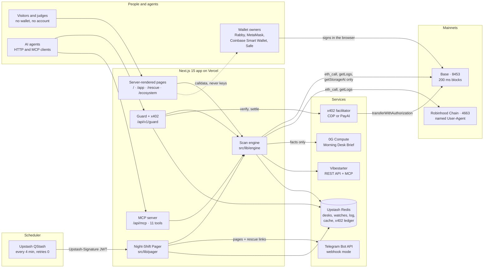
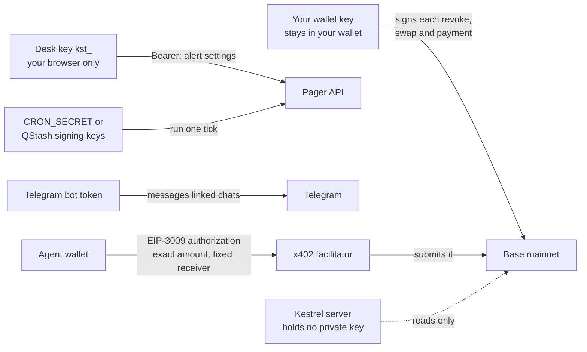
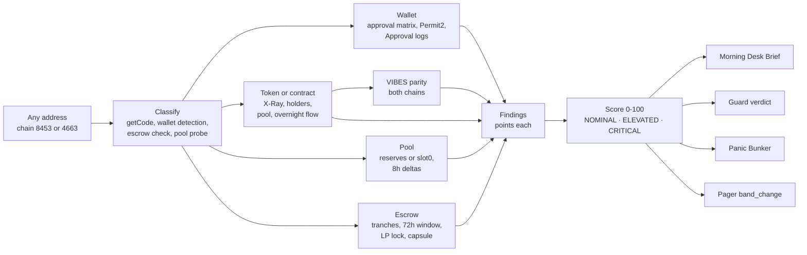
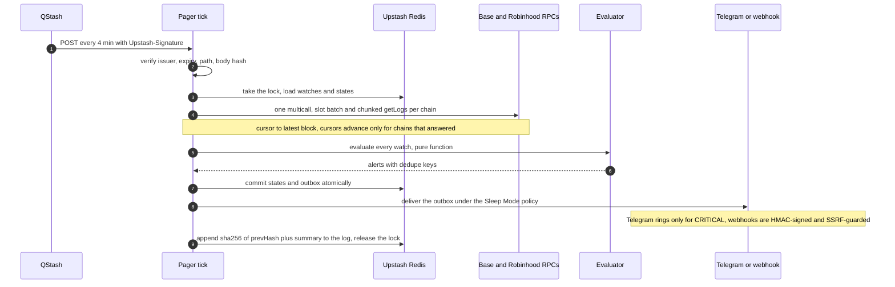
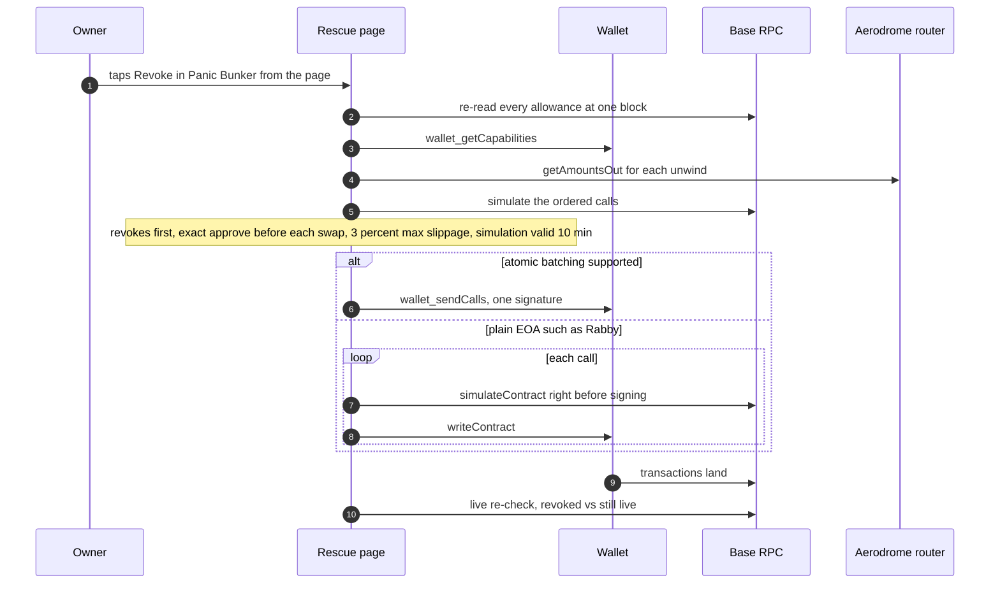
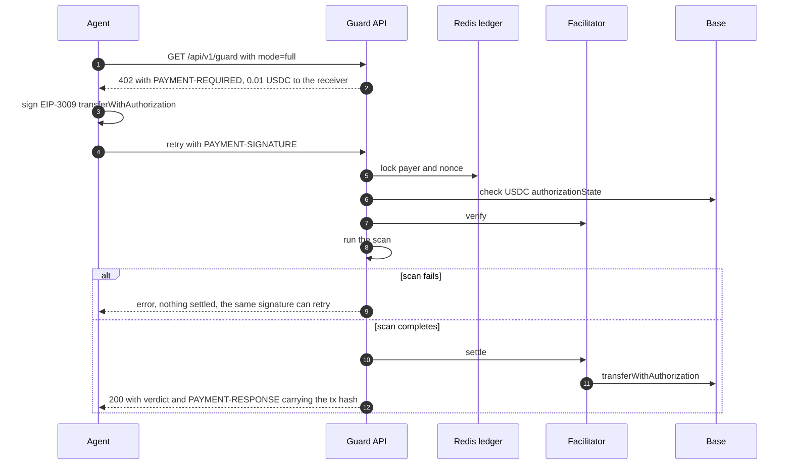
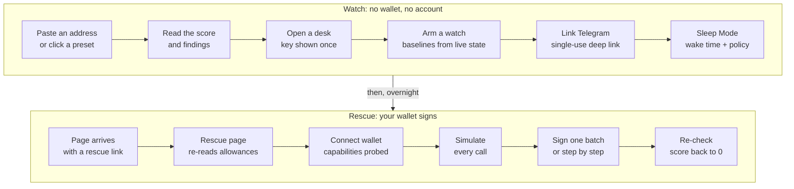

# Kestrel

**Kestrel watches wallets, tokens, pools and Vibestarter escrows on Base and Robinhood Chain overnight, pages you when one turns risky, and walks your wallet back out with a simulated, non-custodial rescue.**

*Stay asleep. Kestrel watches the chain.* Every target gets an **Overnight Threat score from 0 to 100** (NOMINAL 0-29, ELEVATED 30-64, CRITICAL 65-100). The score is the sum of documented findings, each read live from mainnet over RPC (remote procedure call) at a stated block. Everything Kestrel does is measured by one thing: **getting a risky wallet back to 0**.

Built for Vibestarter **Vibeathon 02: Night Shift** · Independent project, not affiliated with Base, Robinhood, LayerZero, Aerodrome or Uniswap · App: [usekestrel.vercel.app](https://usekestrel.vercel.app) · Demo: [watch the 3-minute film](https://youtu.be/uoDrMigaJfo) · Code: [github.com/mrnetwork0001/Kestrel](https://github.com/mrnetwork0001/Kestrel) (MIT) · Fundable: [83/100 FUNDABLE](https://fundable.vibestarter.xyz/s/jP9wHKCNZP) (scored 2026-11-08)

**Judges, start here:** open [usekestrel.vercel.app](https://usekestrel.vercel.app) and click a mainnet preset, then [preview a live rescue](https://usekestrel.vercel.app/rescue?target=0x05CEa6C36f3a44944A4F4bA39B1820677AcB97EE&chain=8453) with no wallet. The technical write-up is [/how-it-works](https://usekestrel.vercel.app/how-it-works), the agent docs are [/agents](https://usekestrel.vercel.app/agents), and the whole product fits in one fetch at [/llms.txt](https://usekestrel.vercel.app/llms.txt).

---

## Four verbs, no wallet needed

| Verb | What it is | Try it without a wallet |
| --- | --- | --- |
| **Scan** | Paste any address on Base (chain 8453) or Robinhood Chain (chain 4663). Kestrel classifies it as a wallet, token, pool, Vibestarter escrow or contract, runs the matching live readers and scores it. The points are public: +10 per unlimited approval (capped at 40), +15 when approvals were granted overnight, +25 when a single EOA (externally owned account, a plain private key) can upgrade the contract, +30 for a pending backer challenge on an escrow. A **Morning Desk Brief** explains the result in plain English, and each scan gets a shareable Threat Card image. | Click a preset on `/`, or open `/app?target=0xefFC8815487084a97edfdfF968b56Ea123421Acb&chain=8453` ($VIBES on Base). |
| **Page** | The **Night-Shift Pager** watches targets 24/7. You open an anonymous desk (no account), arm watches with 16 rule types (new approval, LP liquidity pulled, proxy upgrade, admin change, OFT parity drift, 72-hour challenge window opening, and more), and link Telegram or a webhook. Upstash QStash runs a sentinel pass every 4 minutes. Every page carries a 1-tap link into the Panic Bunker. **Sleep Mode** holds non-critical alerts until your wake time, then sends a "While You Slept" digest. | `/app?tab=pager`. The public, hash-chained Night-Shift Log is at `/api/pager/status`. |
| **Rescue** | The **Panic Bunker** builds one rescue on Base: `approve(spender, 0)` for each risky ERC-20 allowance, `Permit2.lockdown()` for Permit2 sub-allowances, and an optional unwind to USDC through the Aerodrome router at a live quote. Each unwind uses an exact-amount approve and a 3% maximum slippage. Revokes always go first. Every call is simulated before you sign. If your wallet supports EIP-5792 atomic batching (`wallet_sendCalls`), the whole rescue is one signature; otherwise Kestrel guides you through sequential signatures. *Three unlimited approvals at 06:56 UTC. Paged, revoked and unwound by 07:07:37: six transactions in 32 seconds, and every allowance back to 0.* | `/rescue?target=0x05CEa6C36f3a44944A4F4bA39B1820677AcB97EE&chain=8453`: Send's public treasury Safe, which holds live unlimited approvals (4 on 2026-11-08). Kestrel only reads it. The page renders its allowances and the exact rescue calldata, and only the Safe's owners could sign. |
| **Gate** | The same score, built for AI agents. `GET/POST /api/v1/guard` answers `ALLOW`, `WARN` or `BLOCK` using the same bands (30 or more is WARN, 65 or more is BLOCK), together with the reasons, a simulated 1% exit slippage and the pool depth. It fails closed. The preview tier is free. The full tier costs 0.01 USDC per call through x402 (HTTP 402 "Payment Required" micropayments) on Base, and the payment is settled onchain before the verdict is returned. The same engine is also exposed as an MCP (Model Context Protocol) server with 11 tools. | `/agents`, then **Simulate Agent x402 Call**: steps 1 and 2 are plain GETs. Free verdict: `/api/v1/guard?address=0xefFC8815487084a97edfdfF968b56Ea123421Acb&chainId=8453`. |

### More to explore (no wallet needed)

| Feature | What it is | Where |
| --- | --- | --- |
| **Rug Lab** (Simulate the Rug) | Exact `BigInt` AMM (automated market maker) math on live pools: Aerodrome constant product (`getReserves`) and concentrated liquidity (`slot0.sqrtPriceX96` plus `liquidity`). Scenarios: top whale dumps 100%, 50% of liquidity pulled, OFT bridge rate limit saturated, black-swan cascade. Shows price impact and what your exit is still worth. Nothing is traded. | `/app?target=0x07F78058685b75F89288f025a0a154A96021Ac45&chain=8453&tab=chaos` |
| **Parity Radar** | Checks the $VIBES LayerZero OFT (Omnichain Fungible Token) invariant on both chains at their latest blocks: Base adapter balance equals Robinhood supply minus the Robinhood reserve adapter. Possible verdicts are EXACT, IN_FLIGHT, OVER_BACKED or UNBACKED. Also shows bridge lane details (LayerZero fee, credit budget, pause flags, DVNs (decentralized verifier networks), undelivered packets) and the Aerodrome vs Uniswap v3 spread, with net edge after fees and gas. On 2026-11-08 10:09 UTC it read EXACT, with 56,937,667.73 VIBES on each side and a 204 bps spread worth -7 bps net. | `/app?target=0xefFC8815487084a97edfdfF968b56Ea123421Acb&chain=8453&tab=parity`, `/api/parity` |
| **Backer Shield** | Every `VibesTranchEscrow` on both chains: the 10% kickstart plus six 15% monthly tranches, live 72-hour challenge-window countdowns on the escrow's own clock, Proof-of-Lock for the LP, Refund Radar, the Origin Capsule, founder GitHub activity and a live HTTP probe of the founder's app. **Challenge Co-pilot** shows the bond and the 20% slash at risk. **Challenge Dry-Run** runs the deployed escrow bytecode in `eth_simulateV1` and never broadcasts. | `/app?target=0x0e9bf34baed84a80d7647dafe4db52169147c911&chain=8453&tab=shield` (the Genesis $VIBES escrow: 123.4597 ETH raised, 5 of 7 tranches paid) |
| **Bytecode and proxy X-Ray** | An opcode-level walk of `eth_getCode` plus the EIP-1967 implementation, admin and beacon slots. Detects the proxy kind and who holds upgrade authority (Safe m-of-n, EOA, EIP-7702 delegate, renounced), and flags risky capabilities: mint, pause, blacklist, tax, upgrade and `SELFDESTRUCT`. | Briefing tab of any contract scan |
| **Ecosystem Health Board** | Every Vibestarter launch in one server-rendered table: X-Ray score, Proof-of-Lock, pool depth, escrow state, refunds, app health. On 2026-11-08 it covered 5 launches (4 on Base, 1 on Robinhood Chain), and 5 of 5 apps answered. | `/ecosystem`, `/api/ecosystem` |
| **Vibestarter Pulse** | Platform figures pulled at runtime from Vibestarter's own MCP server (`get_platform_stats`, `list_raises`), with the "liquidity locked" figure reconciled against `VibesLPLockerV2` onchain. | `/api/backer-shield?view=pulse` |
| **Sentinel Watch** | The landing hero: a 60-second watch face in which every bar is one real Base or Robinhood block (from `eth_feeHistory`) and every mark is one real Permit2, $VIBES, OFT or Vibestarter log. It is replayed a few seconds behind the newest block, and the page says so. | `/` |
| **x402 revenue proof** | Base USDC transfers into the receiver, read onchain. On 2026-11-08 it showed 1 settlement, 0.01 USDC, from 1 payer. | `/api/x402/revenue` |
| **Docs for machines** | OpenAPI 3.1 for every route, `/llms.txt`, and the MCP server. | `/api/openapi.json`, `/llms.txt`, `/api/mcp` |

The header links to App, Panic Bunker, Ecosystem, How it works and Agents · x402 · MCP, plus `/llms.txt`. On phones these fold into a slide-out menu. A telemetry ribbon under the header shows live block heights on both chains and the $VIBES parity status. There is no login. A wallet is only needed to sign a rescue, through wagmi: injected wallets (EIP-6963 discovery), Coinbase Wallet including Smart Wallet, and WalletConnect when a project ID is set. The `/app` workspace has six tabs (Briefing, Rug Lab, Parity, Backer Shield, Panic Bunker, Pager), and you can deep-link to any of them with `?target=0x…&chain=8453|4663&tab=…`.

## Why live chain reads are essential

No RPC read, no Kestrel. Every number comes from the chain at a stated block, or from Vibestarter's public API or MCP server.

- **No live read, no score.** Findings are built from `eth_call`, `eth_getStorageAt` and `eth_getLogs` results (`src/lib/engine/scan.ts`, `src/lib/engine/findings.ts`). If a secondary read fails, the scan says "degraded", is never cached, and is never called clean (`scanDegradedReasons`). An incomplete approval scan adds a "coverage partial" warning instead of an all-clear.
- **No live allowance, no rescue.** The Panic Bunker re-reads every allowance in your browser at a single block before it builds calldata (`src/lib/rescue/live-approvals.ts`). Unwinds are quoted live with `getAmountsOut` (`src/components/app/panic-bunker.tsx`).
- **No simulation, no signature.** Each call is simulated with `simulateContract`, or as an ordered bundle with `eth_simulateV1`, before any wallet prompt. A simulation expires after 10 minutes (`SIM_MAX_AGE_MS`).
- **No onchain settlement, no paid verdict.** The x402 tier verifies the payment, runs the scan, and only returns the verdict after the USDC transfer has settled on Base (`src/app/api/v1/guard/route.ts`, `src/lib/x402.ts`).
- **No two-chain read, no parity.** The OFT invariant is checked on Base and Robinhood Chain at their latest blocks. UNBACKED is only reported after a second read confirms it (`src/lib/engine/parity.ts`, `src/lib/engine/oft.ts`).

## Architecture

Kestrel has four layers:
- **The chains:** Base and Robinhood Chain mainnets, read over public or keyed RPCs.
- **The app:** one Next.js 15 app on Vercel that serves every page, API route and the MCP server.
- **The services:** Upstash Redis holds state, 0G Compute writes the brief, the Telegram Bot API delivers pages, and an x402 facilitator settles payments. Vibestarter's REST API and MCP server and the GitHub API provide launch data.
- **The scheduler:** an Upstash QStash schedule calls the pager tick every 4 minutes.

The diagrams below render on GitHub. A shorter feature spec is in [docs/ARCHITECTURE.md](docs/ARCHITECTURE.md), and the deployment runbook is [docs/DEPLOY.md](docs/DEPLOY.md).

### System overview



**One codebase, one engine.** Pages, the guard, the MCP tools and the pager all call the same readers in `src/lib/engine`, so a scan on `/app`, a guard verdict and a pager `band_change` alert always agree. Pages are server-rendered with live data, so the landing page shows real block numbers before any JavaScript runs.

**State.** Upstash Redis (`src/lib/kv.ts`, plain REST, no SDK) holds pager desks, watches, watch state, the outbox, the Night-Shift Log, the x402 replay ledger, rate limits, the daily LLM (large language model) budget, and a read-through response cache (`src/lib/cache.ts`). Without Redis credentials an in-memory store takes over, so local development needs no setup.

**RPC.** `src/lib/rpc.ts` tries keyed server-only endpoints first and then the public ones, with one fallback retry and a per-endpoint circuit breaker. Two network quirks shape the code. Base has produced a block every 200 ms since 2026-11-05, so 8 hours is about 144,000 blocks and log reads are chunked (`src/lib/engine/logs.ts`). Robinhood Chain's Cloudflare firewall returns 403 to default bot User-Agents, so every server request to it sends `Kestrel-Sentinel/1.0`.

**Scheduling.** Vercel Hobby crons fire at most once a day, so Upstash QStash calls `POST /api/pager/tick` on `*/4 * * * *` with retries set to 0. That is 360 messages a day, inside the free tier's 500. `PAGER_CADENCE_SEC` defaults to 240 to match.

### Who holds which key



| Key | Lives in | Can | Can never |
| --- | --- | --- | --- |
| Your wallet key | Your wallet (Rabby, MetaMask, Coinbase Smart Wallet, Safe) | Sign each rescue call or x402 payment you approve | Be requested, seen or stored by Kestrel |
| Desk key `kst_…` | Your browser's localStorage. The server stores only a SHA-256 hash of it | Change one desk's watches, channels and Sleep Mode | Move funds, or see or edit another desk |
| `CRON_SECRET` / QStash signing keys | Vercel environment and the scheduler | Trigger one sentinel tick | Read desk keys or change any setting |
| Telegram bot token + webhook secret | Vercel environment | Message chats that started the bot through a single-use link | Message anyone else |
| x402 receiver | Vercel environment, as an **address only** | Receive 0.01 USDC per settled call | The server holds no key for it |
| Facilitator credentials (CDP JWT keys, or none for PayAI) | Vercel environment | Ask the facilitator to submit the payer's signed authorization | Change the amount or the recipient, which are fixed by the payer's signature |
| LLM key (0G Compute or Anthropic) | Vercel environment | Write the brief's text | Act, sign or change the score, which is computed before the LLM is called |

A search of `src/` finds no private key, mnemonic or raw-transaction code. Every write is built in the browser and signed by the user's own wallet.

### Scan: address to score



Scoring is deterministic: `totalScore()` clamps the sum of finding points to 0-100, and `bandFor()` maps it to a band (`src/lib/engine/findings.ts`). On Base, the wallet scan covers a curated matrix of 37 tokens × 51 verified spenders, Permit2 sub-allowances for 5 routers, and the wallet's Approval logs on those tokens. On Robinhood Chain it covers 4 tokens × 8 spenders. With an indexed log RPC (`BASE_LOGS_RPC_URL`), Base approval discovery runs across all tokens. The brief comes from 0G Compute when it is configured, then Anthropic, then a deterministic text built only from the same findings. External strings are fenced as untrusted data in the prompt.

### Page: one sentinel tick



Facts are recorded exactly once and pages are delivered at least once. Dedupe keys are committed in the same transaction as the outbox, so a crash after the commit re-delivers from the outbox and never fires the alert twice (`src/lib/pager/tick.ts`). The public log verifies its hash chain on every read and reports STALE when the last tick is older than 3× the cadence. On 2026-11-08 at 10:08 UTC, `/api/pager/status` showed 53 ticks since the log began, a chain valid over the last 50, 7 alerts and 3 successful deliveries in that window, and the scheduler kind `qstash`.

### Rescue: from page to zero



When a token is being unwound, its router approval is overwritten by the unwind's exact-amount approve and spent to 0 by the swap, so it needs no separate revoke. Smart-wallet users can keep revokes in a separate batch from the swaps, so the revokes still land if a swap reverts.

### Gate: one paid agent call



Both x402 v2 (`PAYMENT-SIGNATURE`, network `eip155:8453`) and legacy v1 (`X-PAYMENT`, network `base`) are accepted. The facilitator is chosen automatically: Coinbase CDP (Coinbase Developer Platform) when its keys are set, otherwise PayAI's keyless tier (`src/lib/x402-facilitator.ts`).

### Onboarding



You can also arm a watch from an agent with the MCP `create_watch` tool. It opens a desk and returns a `manageUrl` (`/app?tab=pager#desk=…`). The key travels in the URL fragment, which is never sent to the server.

### A real night, end to end

On Sunday 2026-11-08 the owner's demo wallet [`0xCd0a…3c02`](https://basescan.org/address/0xCd0a2370F2dC12c1802707B7d9aB3fec891E3c02) (a Base EOA in Rabby) granted three unlimited approvals within 77 seconds: USDC to Permit2 at 06:55:38 UTC ([`0xea2c13aa…`](https://basescan.org/tx/0xea2c13aac5558b8ca87413489d3a6da21b1d7f0a3d82a6c8edfa712e21a0733e)), VIBES to the Aerodrome Router at 06:56:17 ([`0x22bf1d24…`](https://basescan.org/tx/0x22bf1d244c327561e06a427d2ba55cd35b5ada4a161eb077b5c9348134bc941b)), and WETH to the Uniswap Universal Router at 06:56:55 ([`0x86d4d64f…`](https://basescan.org/tx/0x86d4d64f652f7dcecc99042852d57d2b928900dae7b5b14ec21921ff2bb7ffe4)).

1. **Scored.** Production rated the wallet **45/100 ELEVATED**: 3 unlimited approvals × 10 = 30, plus 15 for approvals granted overnight.
2. **Paged.** The pager's QStash ticks sent Telegram CRITICAL pages for each approval, each with a "Revoke in Panic Bunker" link.
3. **Rescued.** Rabby reports no EIP-5792 atomic batching, so the Panic Bunker ran guided sequential signing: 6 transactions from 07:07:05 to 07:07:37 UTC (32 seconds).
   - revoke WETH to Universal Router ([`0xa3ca5b37…`](https://basescan.org/tx/0xa3ca5b3757abcf39a28d7dc6d897da42e11b7d05ea54e2f799e4101b7ca8e0b4))
   - revoke USDC to Permit2 ([`0x24cf9051…`](https://basescan.org/tx/0x24cf905161a224f529dda9c9aee61d1fb6cd7c33f4b794fea67ced78b9bbfb69))
   - approve exactly 12,358.636 VIBES ([`0xfca37c8f…`](https://basescan.org/tx/0xfca37c8f842be209891c8436529700936aec533c315f9f581a841007dfc12c07)) and swap it for 1.963096 USDC ([`0x5d1a02b4…`](https://basescan.org/tx/0x5d1a02b49ecb16066a81429a8036e667efc2661e90c4388809ba9638322c0cac)). This replaced the unlimited VIBES approval and spent it to 0.
   - approve exactly 0.0015 WETH ([`0x41ce2c99…`](https://basescan.org/tx/0x41ce2c999ab43fe11de53d833a5d847afca516fc1027f778b67e15a6041071e7)) and swap it for 3.346594 USDC ([`0x8752ce32…`](https://basescan.org/tx/0x8752ce3215e6f8b340964650941f407f3daa71e73e6cf92616d1a1f98e27aa64))
4. **Resolved.** All allowances were back to 0, the score was 0, and Telegram sent "RESOLVED" pages at 07:08 UTC. A re-read at Base block 54,711,201 (2026-11-08 ~10:12 UTC) still shows all four allowances at 0.
5. **Paid.** At 07:25:19 UTC the first x402 paid guard call settled: 0.01 USDC from the demo wallet to the receiver [`0xEbB9…C426`](https://basescan.org/address/0xEbB92c8f27368222E4B722FB386DbC6Fe80CC426), submitted by the facilitator through EIP-3009 ([`0xe79c92c1…`](https://basescan.org/tx/0xe79c92c1a29ccb3ef6efa848fffd34650b732941699c68f54d818f490a3522ee)).

## Safety

- **Kestrel holds no private key.** The server only reads the chain. Rescue calls are built in the browser and signed by your wallet through wagmi (EIP-1193, EIP-6963, EIP-5792). Kestrel never asks for, accepts or logs a key or seed phrase.
- **Every write is simulated first.** `simulateContract` per call, or `eth_simulateV1` for the ordered bundle, runs before any prompt, and reverts are decoded into readable errors. A simulation older than 10 minutes must be redone.
- **Rescue limits.** Revokes come before swaps. Each unwind approve is for the exact swap amount, never unlimited. Swaps have a 3% minimum-output bound (`SLIPPAGE_BPS = 300n`) and a fresh deadline. The Challenge Co-pilot's bond approvals are also exact.
- **Fail closed.** The guard returns BLOCK for a trade on an address with no contract code. Any failed live read raises the verdict to at least WARN with `status: "degraded"`, and an address that cannot be classified returns WARN, never ALLOW (`src/lib/engine/guard.ts`). A partial approval scan adds 5 points and says "UNKNOWN, not clean".
- **Pager limits** (`src/lib/pager/limits.ts`): 10 watches per desk, 500 in total, 60% of the total reserved for desks without a verified channel, 20 desks per network per day, 5,000 desks in total, and per-route rate limits. Webhooks pass an SSRF (server-side request forgery) guard: private ranges are blocked, DNS is re-resolved and the IP pinned at send time, and redirects are refused. Generic webhooks are HMAC-signed (`X-Kestrel-Signature`). Telegram only messages chats that started the bot.
- **x402 replay protection.** An atomic (payer, nonce) lock in Redis, the USDC `authorizationState` checked onchain, and one 200 per settlement transaction. Without a receiver, `mode=full` answers 501. In production without Redis it answers 503 instead of risking replays.
- **The LLM cannot act.** It only writes the brief's text, after the score is fixed. Untrusted strings are fenced, a daily budget (`BRIEF_LLM_DAILY_CAP`, default 300) fails closed, and token names and campaign titles are rendered as plain text (no `dangerouslySetInnerHTML` anywhere in `src/`).
- **Anti-clickjacking.** Every route sends `frame-ancestors 'none'` and `X-Frame-Options: DENY` (`next.config.ts`), so the signing pages cannot be framed.
- **Secrets stay server-side.** Keyed RPC URLs are read only on the server and scrubbed from error messages. `NEXT_PUBLIC_*` values carry only public endpoints.
- **Tests.** The unit suite (20 tests, all passing on 2026-11-08) covers the Sentinel Watch replay clock, its geometry and the pulse log decoder. Scoring, the pager and the rescue have no automated tests. They were verified end to end on mainnet (above) and by `scripts/verify-onchain.mjs`.

## What's real and what's simulated

| Real | Simulated |
| --- | --- |
| Every score input: bytecode, storage slots, allowances, balances, logs, reserves, escrow state, read at a stated block on Base and Robinhood Chain | **Rug Lab** scenarios: exact AMM math on live reserves, nothing traded |
| $VIBES OFT parity and LayerZero lane data | **Challenge Dry-Run**: the real escrow bytecode in `eth_simulateV1` with synthetic actors and listed storage overrides, nothing broadcast |
| Night-Shift Pager ticks, Telegram and webhook pages, the hash-chained log | Pager **watch tests** and **Evaluate**: dry runs, labelled TEST when sent |
| Panic Bunker transactions, signed by the user's wallet | Panic Bunker **previews**: simulations shown before signing, and the Send treasury Safe demo, which no one but its owners can sign |
| x402 settlements in Base USDC, provable at `/api/x402/revenue` | The `/agents` playground's first two steps are real GETs (free verdict, real 402), and paying is up to the caller |
| Vibestarter campaigns (REST API) and Pulse (Vibestarter MCP), founder GitHub, app HTTP probes | Challenge Co-pilot's refund-if-upheld estimate, computed by `upholdChallenge()` inside `eth_simulateV1` |
| ETH/USD from the live `slot0` of Uniswap v3 WETH/USDC 0.05% on Base (no offchain oracle) | The Sentinel Watch is replayed a disclosed few seconds behind the newest block |
| The Morning Desk Brief from 0G Compute when configured | The brief's fallback is a deterministic template filled only with live findings, labelled as such |

## Tech stack

Next.js 15.5 (App Router, React 19.3), TypeScript 5.9, Tailwind CSS 4.3, viem 2.57 and wagmi 2.19 (injected, Coinbase Wallet, WalletConnect connectors), TanStack Query 5, Upstash Redis over REST, Upstash QStash, Telegram Bot API (webhook mode), 0G Compute Router (OpenAI-compatible; production model `claude-sonnet-5.5`) with the Anthropic SDK 1.4 as the second provider, x402 v2 and v1 with Coinbase CDP SDK 1.60 or the PayAI facilitator, Vibestarter REST API and MCP server, LayerZero Scan API, GitHub API, Base and Robinhood Chain mainnets, Vercel.

## Run it locally

**Prerequisites:** Node 20 or later (`engines` in `package.json`). The unit tests import TypeScript directly, which needs Node 22.18 or later. No API key is needed: every onchain read works on public RPCs, and state lives in memory.

```bash
npm install
cp .env.example .env.local   # every value is optional locally
npm run dev                  # Next.js default port 3000; links fall back to http://localhost:3002 when NEXT_PUBLIC_APP_URL is unset
```

Under `next dev`, an in-process scheduler runs the pager tick every 60 seconds (`PAGER_INPROCESS`), and pager data is snapshotted to `.next/cache/kestrel-dev-kv.json` so desks survive restarts.

| Variable | What it does |
| --- | --- |
| `NEXT_PUBLIC_APP_URL` | Canonical origin for sitemap, OpenAPI `servers`, pager deep links and the MCP Origin allow-list. Unset: Vercel's production URL, then `VERCEL_URL`, then the request origin, then `http://localhost:3002`. |
| `BASE_RPC_URL(S)`, `ROBINHOOD_RPC_URL(S)` | Server-only (optionally keyed) read RPCs, tried before the public ones. Unset: public endpoints only. |
| `BASE_LOGS_RPC_URL`, `BASE_LOGS_MAX_RANGE` (default 10000) | Indexed Base RPC for `eth_getLogs`. When set, approval discovery runs across all tokens, not just the curated list. Unset: publicnode. |
| `NEXT_PUBLIC_BASE_RPC_URL`, `NEXT_PUBLIC_BASE_FALLBACK_RPC_URL`, `NEXT_PUBLIC_ROBINHOOD_RPC_URL` | Browser RPCs for wallet reads. Public endpoints only, because they are inlined into the client bundle. |
| `KV_REST_API_URL` / `_TOKEN` (or `UPSTASH_REDIS_REST_URL` / `_TOKEN`), `KV_DEV_SNAPSHOT` | Shared state. Required in production: without it the pager answers 503 and the x402 paid tier refuses payments. Unset locally: in-memory store. |
| `CRON_SECRET`, `QSTASH_CURRENT_SIGNING_KEY` / `QSTASH_NEXT_SIGNING_KEY` | Scheduler auth for `/api/pager/tick`. Without either, production only gets opportunistic ticks from status visits. |
| `TELEGRAM_BOT_TOKEN`, `TELEGRAM_BOT_USERNAME`, `TELEGRAM_WEBHOOK_SECRET` | Telegram delivery. Setting the webhook secret switches from polling to webhook mode. Unset: webhooks only. |
| `PAGER_CADENCE_SEC` (240), `PAGER_TICK_BUDGET_MS` (40000), `PAGER_SCANS_PER_TICK` (2), `PAGER_MAX_WATCHES_PER_DESK` (10), `PAGER_MAX_WATCHES_TOTAL` (500), `PAGER_MAX_CHANNELLESS_WATCHES` (60% of total), `PAGER_MAX_DESKS_PER_IP_DAY` (20), `PAGER_MAX_DESKS_TOTAL` (5000), `PAGER_IP_SALT`, `PAGER_SYSTEM_DESK_ID` | Pager tuning and caps (defaults in brackets). |
| `PAGER_INPROCESS` (1), `PAGER_INPROCESS_INTERVAL_SEC` (60) | In-process scheduler for `next dev` or self-hosted Node. It never runs on Vercel. |
| `X402_RECEIVER_ADDRESS`, `X402_PRICE_USDC_ATOMIC` (10000 = 0.01 USDC), `X402_MAX_TIMEOUT_SECONDS` (300), `X402_LEDGER_FROM_BLOCK`, `X402_ALLOW_MEMORY_LEDGER` | The paid guard tier. Without a receiver, `mode=full` answers 501 and the free tier still works. |
| `X402_FACILITATOR` (`auto`), `X402_FACILITATOR_URL`, `CDP_API_KEY_ID` / `_SECRET`, `PAYAI_API_KEY_ID` / `_SECRET` | Facilitator choice: CDP when its keys are set, otherwise PayAI keyless, or a custom URL. |
| `ZG_COMPUTE_API_KEY`, `ZG_COMPUTE_MODEL`, `ZG_COMPUTE_BASE_URL` | Morning Desk Brief on 0G Compute (key and model both required). |
| `ANTHROPIC_API_KEY`, `ANTHROPIC_MODEL` (`claude-opus-5-5`) | Second LLM provider. With no provider, the brief is deterministic. |
| `BRIEF_LLM_DAILY_CAP` (300, alias `LLM_DAILY_CAP`) | LLM calls per UTC day across all instances. `0` disables the LLM. |
| `GITHUB_TOKEN` | Raises the GitHub rate limit for founder activity (anonymous access allows 60 requests per hour). |
| `VIBESTARTER_MCP_URL` (`https://app.vibestarter.xyz/mcp`) | Vibestarter MCP server used for Pulse and the launch list. |
| `NEXT_PUBLIC_WALLETCONNECT_PROJECT_ID` | Turns on WalletConnect. Injected wallets and Coinbase Smart Wallet work without it. |
| `NEXT_DIST_DIR` (`.next`) | Lets `next build` write to another folder while `next dev` keeps `.next`. |

The full list with comments is in [`.env.example`](.env.example).

**Tests and checks:**

```bash
node --test scripts/*.test.mjs   # unit suite (Node >= 22.18)
npm run typecheck                # tsc --noEmit
node scripts/verify-onchain.mjs  # live Base + Robinhood check: OFT parity, both pools, Genesis escrow (no npm install needed)
npm run build
```

**Test status (2026-11-08, 10:09 UTC, Node 26.5.0):**
- **Unit suite:** 20 of 20 pass (`ℹ tests 20` · `ℹ pass 20` · `ℹ fail 0`).
- **Typecheck:** no errors in `src/`. Stale generated types in `.next-build/` from an earlier build still reference the removed `/token` page and produce 3 errors there. Delete `.next-build/` to clear them.
- **Onchain check:** `>_ ALL ONCHAIN SYSTEMS NOMINAL. READY FOR CLAUDE CODE BUILD.` at Base block 54,711,127 and Robinhood block 109,148,916. Parity was exact (56,937,667.730168 VIBES on both sides) with a 204 bps cross-venue spread.

## Deploying

The full runbook is [docs/DEPLOY.md](docs/DEPLOY.md).

1. **Vercel.** Import the repository as a Next.js project. Set the environment variables before the first build, because `NEXT_PUBLIC_*` values are inlined at build time. Also set `VERCEL_FORCE_NO_BUILD_CACHE=1`: a stale build cache once broke git-triggered deploys. `.vercelignore` keeps `video/` out of the upload.
2. **Upstash Redis.** Install it from the Vercel Marketplace so `KV_REST_API_URL` and `KV_REST_API_TOKEN` are injected. Production pager and x402 routes refuse to run without it.
3. **Upstash QStash.** Create a schedule that sends `POST https://<APP_URL>/api/pager/tick` on `*/4 * * * *` with retries set to 0, because retries count against the 500 messages a day free tier and a missed tick is covered by the next one. Install QStash from Vercel Storage (no custom prefix) so the signing keys are added. cron-job.org with `Authorization: Bearer <CRON_SECRET>` and `?async=1` also works.
4. **Telegram.** Create a bot with BotFather and set `TELEGRAM_BOT_TOKEN`, `TELEGRAM_BOT_USERNAME` and `TELEGRAM_WEBHOOK_SECRET`. Then call `setWebhook` with `url=https://<APP_URL>/api/pager/telegram/webhook` and the same `secret_token`. Use a second bot for localhost, because a bot with a webhook cannot poll.
5. **x402.** Set `X402_RECEIVER_ADDRESS` to a fresh dedicated Base address (not a demo wallet) and leave `X402_FACILITATOR=auto`. `X402_LEDGER_FROM_BLOCK` pins where the revenue scan starts. Production currently uses an automatic start about 24 hours before its first scan.
6. **Brief.** Set the 0G Compute key, base URL and model (`claude-sonnet-5.5` in production) and `BRIEF_LLM_DAILY_CAP=300`.
7. **Smoke test.** `/` shows live blocks. The Genesis escrow loads Backer Shield. The Parity tab reads both chains, which confirms Vercel can reach the Robinhood RPC. `/api/v1/guard?mode=full` answers 402. `tools/list` on `/api/mcp` returns 11 tools. `/api/pager/status` shows a tick from the last few minutes.
8. **Production** is live at [usekestrel.vercel.app](https://usekestrel.vercel.app). On 2026-11-08 `/api/pager/status` reported `storage: upstash`, scheduler `qstash`, Telegram `webhook`, cadence 240 s, and healthy.
9. **First live run.** The night of 2026-11-08 described above: three approvals paged, revoked and unwound in 32 seconds, followed by the first settled x402 call ([`0xe79c92c1…`](https://basescan.org/tx/0xe79c92c1a29ccb3ef6efa848fffd34650b732941699c68f54d818f490a3522ee)).

## Repository map

```
src/app/                    pages: / (landing, SSR telemetry), /app (six-tab workspace), /rescue (Panic Bunker deep link),
                            /ecosystem, /how-it-works, /agents; error pages, robots, sitemap, icons, OG and Twitter images
src/app/api/                scan, brief, card (Threat Card PNG), telemetry, pulse, parity, backer-shield, challenge, ecosystem,
                            rpc-health, v1/guard (x402), x402/revenue, mcp, openapi.json, pager/* (desk, watches, sleep,
                            telegram link + webhook, test, tick, status)
src/lib/engine/             scan + findings (score), wallet approvals, xray, pools, flow, parity + oft, escrow, guard, brief,
                            logs (chunked getLogs), pulse (Sentinel Watch feed), x402-revenue, github, vibestarter-api
src/lib/pager/              rules (16 types), evaluate, probes, tick, store, deliver, telegram, render, digest, arm,
                            limits, ssrf, schedule-auth (QStash JWT + CRON_SECRET), scheduler (in-process, dev only)
src/lib/rescue/             live-approvals.ts: client-side allowance re-read at one block
src/lib/vibestarter/        escrow + challenge ABIs, Challenge Co-pilot and Dry-Run, Proof-of-Lock, ecosystem board,
                            launch universe, MCP client, Pulse
src/lib/                    x402.ts + x402-facilitator.ts, kv.ts (Upstash REST or memory), cache.ts, rpc.ts (failover +
                            circuit breaker), amm-math.ts, bridge-math.ts, bytecode-signatures.ts, wagmi.ts, abis
src/config/                 chains.ts (8453, 4663, Robinhood User-Agent), contracts.ts (verified addresses, curated tokens
                            and spenders, presets), demo.ts (Send treasury Safe), layerzero.ts, price-feeds.ts
src/components/             app/ (workspace tabs, Panic Bunker, pager UI), hero-sentinel/ (Sentinel Watch), landing/,
                            x402 playground and revenue panel, telemetry ribbon, site chrome
public/llms.txt             the whole product and API surface for AI readers
scripts/                    verify-onchain.mjs (live dual-chain check), sentinel-watch.test.mjs (unit suite)
docs/                       ARCHITECTURE.md, DEPLOY.md, DESIGN_SYSTEM.md, ROADMAP_5_DAYS.md, contracts/vibestarter-base.json
video/                      the demo film (Remotion), its on-chain data and capture scripts; see video/README.md
.claude/commands/           Claude Code slash commands: kickoff, verify-onchain, audit-fundable
.mcp.json                   Vibestarter's MCP server for Claude Code sessions
```

## Content policy

Token names, symbols and campaign titles come from other people's contracts and APIs, so they are always rendered as plain text and fenced as untrusted data in LLM prompts. The 1-click rescue demo reads a public Safe identified by its Basescan public name tag ("Send: 4/7 Multisig - Treasury"). Kestrel never acts on it. Base, Robinhood Chain, LayerZero, Aerodrome, Uniswap and Vibestarter names belong to their owners.

## Pre-existing work and credits

- **Next.js scaffold** (config files, base layout) set up for this project on 2026-11-07.
- **Deployed third-party contracts, read only:** Vibestarter (`VibesTranchEscrowFactory`, `VibesTranchEscrow`, `VibesRegistry`, `VibesLPLockerV2`, listed in `docs/contracts/vibestarter-base.json`), the $VIBES LayerZero OFT adapters, Aerodrome and Uniswap v3 pools and routers, Permit2, Base USDC, Safe and Multicall3.
- **Data and services:** Vibestarter's public API and MCP server, LayerZero Scan, the GitHub API, 0G Compute, Telegram, Upstash, and the CDP and PayAI x402 facilitators.
- **Open-source npm packages** are listed in `package.json`.
- **No prior Kestrel code.** Everything else was written for Vibeathon 02 with Claude Code.

## License

MIT, © 2026 encrypt_wizard ([@encrypt_wizard](https://x.com/encrypt_wizard)). See [LICENSE](LICENSE).

---

Kestrel is an independent Vibeathon 02 project. It reads public chains and never holds your keys or funds. Scores, simulations and verdicts are risk signals, not financial advice. Every onchain action you sign carries its own risk.
